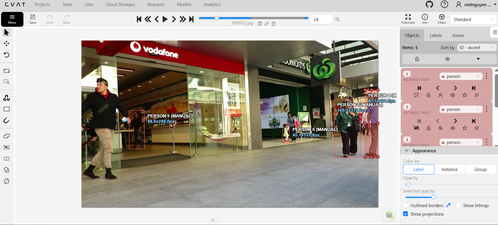
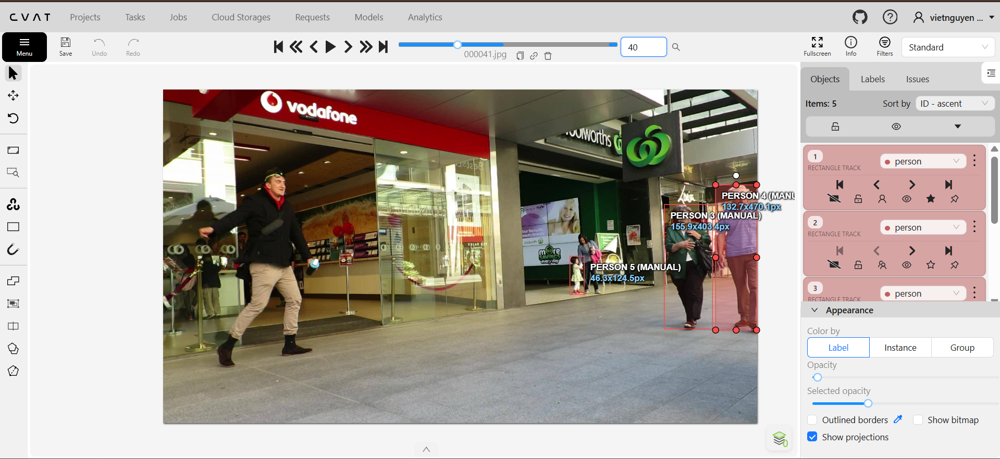
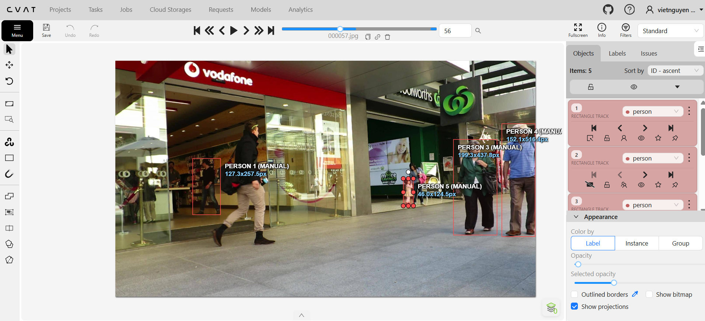

# Báo cáo cá nhân — HoVaTen-MSSV

Đổi tên file theo quy tắc `MSSV_HoTen.md`. Ví dụ: `20241234_NguyenVanAn.md`.

Đoạn video: MOT17-09, 150 frame (frame 1–150), nguồn MOTChallenge, giấy phép CC BY-NC-SA 3.0.

## 0. Thông tin học viên

- Họ tên: Nguyễn Quốc Việt
- MSSV: 202603224
- Mã đề (A/B/C): A
- Email: vietnguyen10022001@gmail.com
- Link repository: https://github.com/nguyenquocviet1002/K5-L2A-DAY05-NguyenQuocViet-03224-MOTTracking
- Giờ bắt đầu:
- Giờ kết thúc:

## 1. Xem trước đoạn video (CP0)

Ghi **trước khi vẽ**, mỗi người một dòng.

### Bảng theo dõi chi tiết các đối tượng (Tracking Log)

| Mã | Frame xuất hiện | Frame cuối thấy được | Rẽ / dừng / đổi tốc độ ở frame | Bị che ở frame | Ghi chú |
|---|---|---|---|---|---|
| **P1** | 1 | ~150 | Không rẽ/dừng. Giữ tốc độ đều. | Không bị che khuất nghiêm trọng. | Nam áo đen, quần kaki, cầm vật xanh. Đi ra khỏi màn hình (mép trái) khoảng frame 85. Bất ngờ xuất hiện trở lại từ mép trái đi sang phải ở khoảng frame 105 và đi đến cuối video. Cần chú ý nối lại ID khi anh ta quay lại. |
| **P2** | 1 | ~125 | Không rẽ/dừng. Giữ tốc độ đều. | ~110 - 120 (Bị người phụ nữ áo xanh lá nhạt đi ngược chiều che khuất một phần). | Nữ áo xanh lá, xách túi đen. Tiến sát về phía camera. Ra khỏi màn hình (góc dưới trái). Cần đánh dấu `outside` khi kết thúc. |
| **P3** | 1 | ~125 | Không rẽ/dừng. Giữ tốc độ đều. | ~110 - 120 (Bị người đi đường khác che khuất một phần). | Nam đội mũ, áo polo xanh, quần nâu. Đi song song và hơi chếch về phía sau P2. Ra khỏi màn hình cùng lúc với P2. |
| **P4** | 1 | ~145 | Không rẽ/dừng. Đi chậm. | ~125 - 150 (Bị khuất sau cột trụ/bức tường màu xanh của cửa hàng Woolworths). | Nữ áo xám, xách túi hồng. Kích thước BBox rất nhỏ do ở xa. Cần zoom to khi vẽ. Biến mất ở khu vực góc trái phía xa. |
| **P5** | 1 | ~145 | Không rẽ/dừng. Đi chậm. | ~125 - 150 (Bị khuất sau cột trụ và đôi khi bị P4 che). | Bé gái váy xanh. Đi cạnh P4. Biến mất cùng lúc với P4 ở khu vực góc trái phía xa. Kích thước BBox cực nhỏ, dễ bị lỗi IoU nếu vẽ lệch. |

## 2. Keyframe và thời gian (CP1, CP4)

Số keyframe lấy từ kết quả `src/check_submission.py`.

| Mã | Số keyframe | Keyframe ở frame | Số frame có mặt | Keyframe / 100 frame | Thời gian (phút) | Chỗ khó |
|---|---|---|---|---|---|---|
| **P1** (Track 0) | 63 | 0, 2, 8-17, 19, 20, 23, 25, 27, 30, 49-55, 60-67, 70, 72-77, 80, 82, 83, 85-92, 94, 95, 100, 103, 109-112, 123, 130, 140, 143, 147, 149 | 139 | 45.3 | ~0.08 (Video) | Di chuyển nhanh, tay vung, quay đầu. Đi ra khỏi màn hình (outside) rồi quay lại, thay đổi hướng đi đột ngột. |
| **P2** (Track 2) | 51 | 0, 1, 2, 5, 7, 10, 14, 20-23, 25, 30, 32, 34, 40, 41, 50, 57, 60-62, 64, 67, 70, 73, 80, 82, 86-88, 90, 92, 96, 100-104, 106, 110, 111, 113, 120, 123, 126, 130, 133, 140, 144, 149 | 150 | 34.0 | ~0.08 (Video) | Đi ngược chiều tiến sát về phía camera. Kích thước BBox thay đổi lớn (Scale Variation). |
| **P3** (Track 3) | 30 | 0, 10, 18, 20, 24, 25, 30, 36, 40, 46, 50, 60, 66, 70, 72, 80, 90, 93, 100, 105, 110, 114, 120, 129, 130, 136, 139, 140, 144, 149 | 150 | 20.0 | ~0.08 (Video) | Đi song song, rất sát P2. Dễ bị nhầm lẫn ID. Bị người đi đường khác che khuất. |
| **P4** (Track 4) | 18 | 0, 4, 8, 10, 11, 17, 20, 30, 40, 50, 77, 100, 106, 107, 136, 140, 141, 144 | 121 | 14.9 | ~0.07 (Video) | Kích thước BBox cực nhỏ (ở xa). Bị khuất hoàn toàn sau cột trụ (mất dấu 110-135). |
| **P5** (Track 1) | 32 | 60, 61, 66, 67, 71, 76-79, 81, 83, 86, 91, 97, 101, 104, 111-113, 115, 121, 123, 125, 126, 129-131, 134, 141, 142, 147, 149 | 90 | 35.6 | ~0.05 (Video) | BBox rất nhỏ, dễ bị trôi (drift) nếu không zoom kỹ. Xuất hiện muộn (từ frame 60). |
| **Tổng** | **194** | *(Chi tiết ở trên)* | **650** | **29.8** | **~0.08 (Video)** | |

Keyframe / 100 frame của cả bài = tổng keyframe ÷ tổng số frame có mặt × 100 = 29.8

Bạn đặt keyframe nhiều nhất ở người nào? Vì sao (người đó rẽ, dừng, lại gần camera hay bị che)?
```
Tôi đặt keyframe nhiều nhất ở P1
Vì: Thay đổi tư thế liên tục, Rời khỏi khung hình và quay lại, Bị che khuất
```

## 3. Đoạn bị che (CP2)

Người bị che: `P1`

| Mốc | Frame |
|---|---:|
| Bắt đầu bị che một phần (bật `occluded`) | ~36 |
| Mất hẳn (bật `outside`) | 38 |
| Hiện lại (tắt `outside`) | 49 |
| Thấy rõ trở lại (tắt `occluded`) | ~52 |

- Thời gian khuất hẳn: 11 frame = 0.37 giây.
- Quyết định: giữ cùng ID.
- Lý do (trả lời 3 câu: khuất bao lâu so với 60 frame, ngoại hình có khớp, chỗ hiện lại có đúng hướng và tốc độ):
```
1. **Khuất bao lâu so với 60 frame:** Thời gian khuất hẳn chỉ là 11 frame, ngắn hơn rất nhiều so với ngưỡng cho phép 60 frame. Do đó, việc giữ nguyên ID là hoàn toàn chính xác và không vi phạm quy tắc chống ID Switch.
  2. **Ngoại hình có khớp:** Khi xuất hiện trở lại, đối tượng vẫn giữ nguyên bộ trang phục đặc trưng (áo khoác đen, quần kaki sáng màu) và tư thế di chuyển (tay cầm vật màu xanh), hoàn toàn khớp với ngoại hình được ghi nhận trước khi bị khuất.
  3. **Chỗ hiện lại có đúng hướng và tốc độ:** P1 mất dấu do bước ra khỏi mép trái màn hình. Khi hiện lại ở frame 49, anh ta tiếp tục di chuyển với tốc độ đi bộ nhanh tương tự, đúng với quỹ đạo dự đoán của một người đi thẳng ra khỏi khung hình và quay trở lại.
```

Ảnh chụp màn hình:





## 4. Tự review ID (CP3)

Lượt 1 theo người (đi ngược từ frame 149 về 0 trên CVAT), lượt 2 theo cảnh (nhảy 10 frame). Ít nhất 3 dòng; không có lỗi thì ghi một dòng "đã kiểm hai lượt, không lỗi".

Loại lỗi dùng đúng một trong 7 mã: `id_switch`, `fragmentation`, `lost`, `merge`, `false_track`, `drift`, `flag`.

| Frame | Mã người | Loại lỗi | Mô tả một câu | Phát hiện ở lượt | Đã sửa? |
|---:|---|---|---|---|---|
| | | | | | |
| | | | | | |
| | | | | | |

Tổng hợp số lỗi theo loại:

| `id_switch` | `fragmentation` | `lost` | `merge` | `false_track` | `drift` | `flag` |
|---:|---:|---:|---:|---:|---:|---:|
| | | | | | | |

Lỗi nào chỉ lượt 2 (theo cảnh) mới thấy, lượt 1 (theo người) không thấy? Vì sao?
```
đã kiểm hai lượt, không lỗi
```

## 5. File xuất và kết quả tự kiểm (CP4)

| Kiểm tra | Kết quả |
|---|---|
| Tên file MOT 1.1 | |
| Tên file CVAT for video 1.1 | |
| Số track ID khác nhau trong `gt/gt.txt` (phải là 5) | |
| Frame `outside` không có dòng trong `gt.txt` (đúng / sai) | |
| Job đã completed trên CVAT máy cá nhân | |

Dán phần tóm tắt in ra từ `src/check_submission.py`:

```
Số frame in theo CVAT (bắt đầu từ 0). Trong gt.txt, frame_id = frame CVAT + 1.

=== File MOT 1.1: NguyenQuocViet_mot.zip ===
  Số track ID: 5   |   Tổng số box: 650
  [OK]        Đúng 5 track ID.

  Track | Frame có mặt | Số frame | Đoạn vắng (outside)
      1 |   0–149      |      139 | 38–48
      2 |   0–149      |      150 | -
      3 |   0–149      |      150 | -
      4 |   0–146      |      121 | 110–135
      5 |  60–149      |       90 | -


=== File CVAT for video 1.1: NguyenQuocViet_cvat_video.zip ===

  Track | Nhãn   | Frame thấy | Keyframe | KF/100 frame | Frame occluded | Lần bật outside
      0 | person |        139 |       63 |         45.3 |             16 |               1
              Track 0: keyframe ở frame [0, 2, 8, 9, 10, 11, 12, 13, 14, 15, 16, 17, 19, 20, 23, 25, 27, 30, 49, 50, 52, 53, 54, 55, 60, 62, 63, 64, 65, 66, 67, 70, 72, 73, 74, 75, 76, 77, 80, 82, 83, 85, 86, 87, 88, 89, 90, 91, 92, 94, 95, 100, 103, 109, 110, 111, 112, 123, 130, 140, 143, 147, 149]
      1 | person |         90 |       32 |         35.6 |             11 |               0
              Track 1: keyframe ở frame [60, 61, 66, 67, 71, 76, 77, 78, 79, 81, 83, 86, 91, 97, 101, 104, 111, 112, 113, 115, 121, 123, 125, 126, 129, 130, 131, 134, 141, 142, 147, 149]
      2 | person |        150 |       51 |         34.0 |              0 |               0
              Track 2: keyframe ở frame [0, 1, 2, 5, 7, 10, 14, 20, 21, 22, 23, 25, 30, 32, 34, 40, 41, 50, 57, 60, 61, 62, 64, 67, 70, 73, 80, 82, 86, 87, 88, 90, 92, 96, 100, 101, 102, 103, 104, 106, 110, 111, 113, 120, 123, 126, 130, 133, 140, 144, 149]
      3 | person |        150 |       30 |         20.0 |             28 |               0
              Track 3: keyframe ở frame [0, 10, 18, 20, 24, 25, 30, 36, 40, 46, 50, 60, 66, 70, 72, 80, 90, 93, 100, 105, 110, 114, 120, 129, 130, 136, 139, 140, 144, 149]
      4 | person |        121 |       18 |         14.9 |             11 |               2
              Track 4: keyframe ở frame [0, 4, 8, 10, 11, 17, 20, 30, 40, 50, 77, 100, 106, 107, 136, 140, 141, 144]

  Tổng: 194 keyframe / 650 frame có mặt = 29.8 keyframe / 100 frame
  [OK]        Đọc được 5 track từ annotations.xml.

=== Tóm tắt ===
  Lỗi: 0   |   Cảnh báo: 0
```

## 6. Ba câu kết

1. Nếu được gán lại, bạn sẽ đặt keyframe khác ở đâu? Vì sao?

   ...

2. Có chỗ nào bạn không chắc "cùng ID hay ID mới"? Bạn đã quyết định và ghi chú thế nào?

   ...

3. Một lỗi ID trong job của bạn (nếu không còn sót, chọn lỗi đã sửa) có thể làm xe tự lái dự đoán sai chuyển động của người đó như thế nào? Lỗi đó ảnh hưởng MOTA hay IDF1 nhiều hơn?

   ...

## Bonus (nếu làm)

### B1 — Hai người đi sát

...

### B2 — So cách đặt keyframe

| Cách đặt | Số keyframe | Frame trôi nhất | Ghi chú |
|---|---:|---:|---|
| Đều mỗi 30 frame | | | |
| Theo chỗ đổi hướng | | | |

...

### B3 — So với tracker có sẵn

| Frame | Mã người | Tracker làm gì | Nhãn của bạn | Giải thích (đoán rồi sửa / ghép IoU / box score thấp / ngoại hình) |
|---:|---|---|---|---|
| | | | | |
| | | | | |

## 7. Tài liệu tham khảo và công cụ AI đã dùng

...
